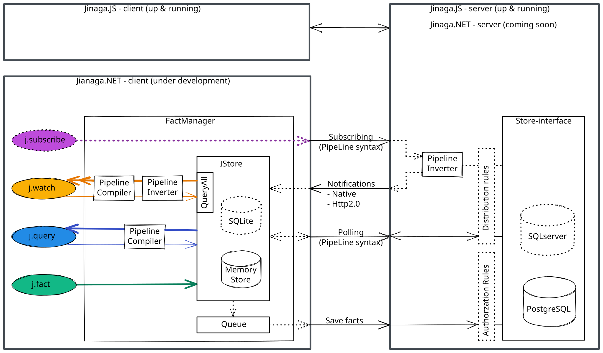

# Jinaga.NET

Resilient, reliable data transfer for .NET.

## What it Does

In [Jinaga](https://jinaga.com), you define a data model in terms of immutable facts.
A fact represents an entity, a change to an entity, or a decision that a user or service has made.

In Jinaga.NET, facts are C# `record`s.:

```C#
[FactType("Corporate.Company")]
record Company(string identifier) {}

[FactType("Corporate.Employee")]
record Employee(Company company, int employeeNumber) {}
```

When a user or service makes a decision, you will add a fact to the system.
This will store it in the local database.
It will also update the local UI.
And it will publish it so that others can learn about the decision.

```C#
var contoso = await j.Fact(new Company("Contoso"));
var jane = await j.Fact(new Employee(contoso, 1));
var bob = await j.Fact(new Employee(contoso, 2));
```

To query facts, write a specification.
Start at a know fact and find all related facts that match that specification.

```C#
var employeesOfCompany = Given<Company>.Match((company, facts) =>
    from employee in facts.OfType<Employee>()
    where employee.company == company
    select employee
);

var contosoEmployees = await j.Query(contoso, employeesOfCompany);
```

A query returns results at a point in time.
If you want to keep a user interface up-to-date, you will need to set up an event-based watch.

```C#
var observer = j.Watch(contoso, employeesOfCompany, employee =>
{
    var component = AddEmployeeComponent(employee);
    return () =>
    {
        RemoveEmployeeComponent(component);
    };
});
```

Finally, if you want to be notified in real time of new information, just change `Watch` to `Subscribe`.

```C#
var subscription = j.Subscribe(contoso, employeesOfCompany, employee =>
{
    var component = AddEmployeeComponent(employee);
    return () =>
    {
        RemoveEmployeeComponent(component);
    };
});
```

The client will open a persistent connection with the server.
The server will notify the client the moment a new employee is hired.
Because the client already set up a watch, the new employee will appear on the UI.

## What a Result Promises

`Query`, `Watch`, and `Subscribe` all answer from the graph of facts that this replica holds.
Knowing what that answer promises, and what it does not, is what keeps a consumer from acting on information that has not settled.

- **A result is exact for this replica's own graph.**
  That graph is always a consistent state: a fact never arrives before its predecessors, so no result is ever computed over half of a change.
- **Replicas are peers.**
  There is no global order and no authoritative answer.
  A result can differ from another replica's until the same facts have reached both, and then the two agree.
  A replicator is a peer with a graph of its own, so comparing a local watch against a query of the replicator compares two replicas.
  It does not check one of them against the truth.
- **A negation is provisional.**
  A `notExists` condition is evaluated over the local graph.
  A row whose negative condition holds here may leave the result when a witness written elsewhere arrives.
  `Watch` and `Subscribe` then call that row's removal function, and `Query`, run again, omits the row.

### Record the Premise

For an action that must not run on a provisional negation, record the premise in the model.
The fact that the handler writes names the facts it acted on.
A concurrent contradiction is then visible in history, and a specification can find it.

Suppose a facility manager assigns an office to each employee who has not been terminated.

```C#
[FactType("Corporate.Facility")]
record Facility(User manager, Company company, string name) {}

[FactType("Corporate.Termination")]
record Termination(Employee employee) {}

[FactType("Corporate.OfficeAssignment")]
record OfficeAssignment(Facility facility, Employee employee, string roomNumber) {}
```

The decision reads a negation, so it is provisional.

```C#
var employeesToAssign = Given<Company>.Match((company, facts) =>
    from employee in facts.OfType<Employee>()
    where employee.company == company
    where !facts.Any<Termination>(termination => termination.employee == employee)
    select employee
);
```

The assignment names the employee that the decision acted on.
That reference is the premise.

```C#
var assignment = await j.Fact(new OfficeAssignment(facility, employee, "101"));
```

A `Termination` written on another replica does not erase that assignment, and it does not need to.
Both facts are in history, so a specification finds the pairs that contradict one another.

```C#
var contradictedAssignments = Given<Facility>.Match((facility, facts) =>
    from assignment in facts.OfType<OfficeAssignment>()
    where assignment.facility == facility
    from termination in facts.OfType<Termination>()
    where termination.employee == assignment.employee
    select assignment
);
```

A watch on that specification tells the facility manager which assignments to revisit.
Without the premise, the contradiction would show up only as a row that quietly left a result.

Where a decision must be unique, name the principal who makes it with an authorization rule.
Only the facility's manager can write an assignment for that facility, so no other principal can make a competing one.

```C#
private static AuthorizationRules Authorization(AuthorizationRules r) => r
    .Any<User>()
    .Type<OfficeAssignment>(assignment => assignment.facility.manager)
    ;
```

## Running a Replicator

A Jinaga front end connects to a device called a Replicator.
The Jinaga Replicator is a single machine in a network.
It stores and shares facts.
To get started, create a Replicator of your very own using [Docker](https://www.docker.com/products/docker-desktop/).

```
docker pull jinaga/jinaga-replicator
docker create --name my-replicator -p8080:8080 jinaga/jinaga-replicator
docker start my-replicator
```

This creates and starts a new container called `my-replicator`.
The container is listening at port 8080 for commands.
Configure Jinaga to use the replicator:

```C#
var j = JinagaClient.Create(options =>
{
    options.HttpEndpoint = new Uri("http://localhost:8080/jinaga");
});
```

## Roadmap

[Jinaga.NET](https://github.com/jinaga/jinaga.net) is co-evolving with [Jinaga.JS](https://github.com/jinaga/jinaga.js).
Each of these projects has a front end and a back end.
Either front end is intended to work with either back end.
And the back ends are intended to interconnect to form a decision substrate.



### Storage

Jiaga.NET currently has support for SQLite and memory storage.
The next storage solution to implement is PostgreSQL to support Docker deployment.
After that, the MS SQL Server implementation will support enterprise solutions that need to keep the journal transactionally consistent with the projection.

## Release

This repository uses [Nerdbank.GitVersioning](https://github.com/dotnet/Nerdbank.GitVersioning) to manage version numbers.
To release a new version of the Jinaga.NET library, create a new release in the format `yyyymmdd.i`.
For example, `20240917.1`.
All of the packages will be versioned separately.
Their version numbers will not be updated if they have not changed.
The packages will be published to [NuGet](https://www.nuget.org/packages/Jinaga/).

To accomplish this from the command line, use the following `gh` command.

```powershell
gh release create 20240917.1 --generate-notes
```
